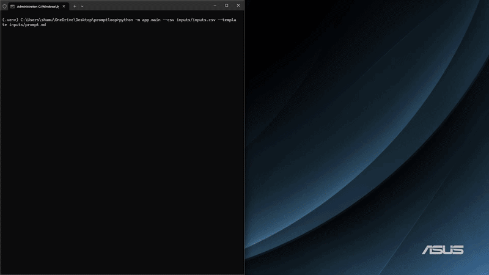

# PromptLoop

PromptLoop is a lightweight command-line tool that automates running a Markdown prompt template over every row of a CSV file through a chatbot web interface, saving each response as an isolated file.

Provide a CSV of inputs and a Markdown prompt with `{variables}`; PromptLoop fills the template for each row, interacts with the browser via Playwright, waits for the response, and preserves state to safely resume interrupted runs.
```
CSV + Markdown -> validation & prompt build -> Playwright -> wait for response
-> extract -> save output & state
```

## 🚀 Demo / Execution Preview

<p align="center">
  
</p>


## Features

- **Automated Browser Management**: Automatically launches Google Chrome with remote debugging and an isolated profile using your `.env` configuration—no manual terminal commands required.
- **Session Persistence**: Keeps your login session intact across runs using a dedicated local Chrome profile directory.
- **Resilient Execution**: Automatically tracks row status in `manifest.json`, allowing you to resume interrupted runs effortlessly.
- **Configurable UI Selectors**: Easily target different chatbot platforms (such as ChatGPT) via environment variables.

## Requirements

- Python 3.10+
- Google Chrome / Chromium (installed by Playwright)

## Install

1. Clone the repository and navigate into the project folder:
```bash
   git clone [https://github.com/YOUR_USERNAME/promptloop.git](https://github.com/ShantiyaShamushaki/promptloop.git)
   cd promptloop
```
2. Create and activate a virtual environment:
```bash
python -m venv .venv
# Windows
.venv\Scripts\activate
```
3. Install dependencies:
```
pip install -r requirements.txt
pip install -e ".[dev]"      # optional: editable install + pytest
python -m playwright install chromium
```
4. Set up your environment variables:
Copy .env.example to .env and specify the path to your Google Chrome executable:
```bash
PROMPTLOOP_CHROME_PATH=C:\Program Files\Google\Chrome\Application\chrome.exe
```

## Usage

```bash
python -m app.main --csv inputs/inputs.csv --template inputs/prompt.md
```

On Windows (single line):

```powershell
python -m app.main --csv inputs/inputs.csv --template inputs/prompt.md
```

The tool will automatically open Chrome with your isolated profile. Log in to the chatbot manually if required, then press y and Enter in the terminal when ready. Once finished, the browser instance will shut down.

### Arguments

| Argument | Description |
|---|---|
| `--csv` | Input CSV file (required) |
| `--template` | Markdown template file (required) |
| `--output` | Output folder (default: `output`) |
| `--resume` | Resume a previous run from `manifest.json` |
| `--limit N` | Process at most N rows (useful for testing) |
| `--profile DIR` | Persistent Chromium profile folder (default: `.browser-profile`) |
| `--no-profile` | Use a temporary session instead of a persistent profile |
| `--headless` | Run Chromium headless |
| `--timeout S` | Seconds to wait for each response (default: 120) |
| `--no-rerun-failed` | Skip rows that previously failed when resuming |
| `--force` | Reprocess rows already marked completed |
| `--verbose` | Verbose logging |

## Inputs

`inputs/inputs.csv`:

```csv
company,industry,country
NVIDIA,Semiconductors,USA
Toyota,Automotive,Japan
ASML,Lithography,Netherlands
```

`inputs/prompt.md`:

```md
Analyze the following company.

Company: {company}
Industry: {industry}
Country: {country}

Provide:
1. A brief overview
2. Competitive advantages
3. Major risks
4. Three questions for further research
```

Every CSV column name can be used as `{column_name}` in the template. Template
variables that have no matching column stop the run before the browser opens.
Columns that are never used only produce a warning.

## Output

```
output/
├── responses/
│   ├── 0001_NVIDIA.md
│   ├── 0002_Toyota.md
│   └── 0003_ASML.md
├── manifest.json
└── run.log
```

Each response file contains the input row, the sent prompt, and the response,
so a response is always traceable to its input. `manifest.json` records the
status of every row and makes `--resume` possible.

## Targeting a chatbot UI

The chatbot URL and selectors are configurable, so no code changes are needed
when the target service changes:

| Environment variable | Default (ChatGPT) |
|---|---|
| `PROMPTLOOP_URL` | `https://chatgpt.com/` |
| `PROMPTLOOP_INPUT_SELECTOR` | `#prompt-textarea` |
| `PROMPTLOOP_SEND_SELECTOR` | `[data-testid="send-button"]` |
| `PROMPTLOOP_STOP_SELECTOR` | `[data-testid="stop-button"]` |
| `PROMPTLOOP_RESPONSE_SELECTOR` | `[data-message-author-role="assistant"]` |
| `PROMPTLOOP_RESPONSE_TIMEOUT_MS` | `120000` |

The defaults are placeholders: inspect the real page and adjust them. Response
completion is detected by waiting for a new assistant message, the stop button
disappearing, and the response text staying stable for a short period; a hard
timeout protects against a UI that never settles.

## Resume behavior

- `completed` rows are skipped.
- `pending` and `in_progress` rows (interrupted) are processed.
- `failed` rows are retried unless `--no-rerun-failed` is given.

Run again with `--resume`:

```bash
python -m app.main --csv inputs/inputs.csv --template inputs/prompt.md --resume
```

## Tests

```bash
pytest
```

## Limitations and security

- Supports one chatbot UI at a time.
- Selectors depend on the service's page and may need updating.
- No parallel execution, no database, no GUI.
- Login and any CAPTCHA/verification are performed by the user; the tool does
  not bypass security controls.
- The browser profile keeps your session. It stays local, is listed in
  `.gitignore`, and must never be committed or shared.
- Use only in a way that is compatible with the target service's terms of use.
